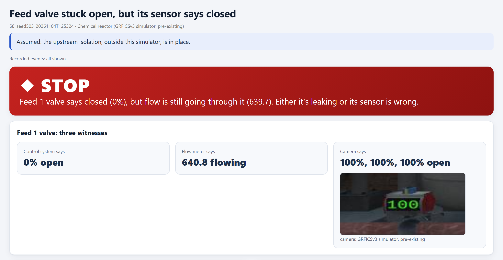

# ZeroState

**A second check before anyone opens a pipe.** ZeroState compares a plant's isolation plan with the plant's own live data and a camera, and says STOP when they disagree. It is read-only. It never gives the go-ahead. A person decides and signs.

- Demo video (3 min): https://youtu.be/jARv_GhjjRE
- Try it, no key needed: https://zerostate-bay.vercel.app
- Every result, with the seal check: https://zerostate-bay.vercel.app/results.html

Built for the Meta Global AI Developer Hackathon (Oct 26 to Nov 4, 2026), Indie track, "Push the Frontier".



*A demo run on the simulated reactor (tuning seed 503, not a benchmark job).*

## The story in five steps

1. A technician is about to open a reactor for repair. They type or say: "I'm about to open the reactor. Check my isolation." Muse Spark finds the reactor's confirmed isolation plan.
2. They close each valve and say "step two done". Muse Voice Transcribe hears it, ZeroState reads it back, and they say "confirm".
3. The feed valve sticks open, but its position sensor still says closed. (This is a simulated fault.)
4. ZeroState asks three witnesses. The control system says the valve is 0 % open. The flow meter says flow is still going through it. The camera says 100 % open: SAM 3.1 finds the valve's display in the frame and Muse Spark reads the number.
5. Two witnesses disagree with the control system, so ZeroState says STOP and explains why. There is no "go" button. A person decides.

## Why this matters

Before maintenance on a pump, vessel or line, every source of energy feeding it has to be isolated: valves closed and locked, the line vented, and the isolation proved. This is lockout/tagout. When it goes wrong, the pipe a worker opens is still full of hot, toxic or flammable fluid.

It goes wrong in two ways, and US Chemical Safety Board investigations show both.

**The instruments said "isolated" and the plant wasn't.**
- BP Amoco, Augusta, 2001: a plugged gauge read zero. 3 workers killed. ([CSB report](https://www.csb.gov/assets/1/20/BP_Investigation_Report.pdf))
- Tosco Avon, 1999: valves were passing and drains were clogged while the line was opened. 4 killed. ([CSB](https://www.csb.gov/assets/1/6/CSB_Digest_-_Tosco_(Preventive_Maintenance).pdf))
- Giant Ciniza, 2004: a valve was open while the crew believed it was closed. ([CSB](https://www.csb.gov/assets/1/20/Giant_Case_Study.pdf))

**The plan or the point was wrong.**
- LyondellBasell La Porte, 2021: the chosen isolation valve was itself under pressure. 2 killed. ([CSB](https://www.csb.gov/assets/1/6/lyb_final_report_2023-05-25.pdf))
- Williams Geismar, 2013: a vessel was boxed in with no relief and then heated. 2 killed. ([CSB](https://www.csb.gov/csb-releases-final-case-study-into-2013-explosion-and-fire-at-williams-olefins-plant-in-geismar-louisiana/))
- Formosa Illiopolis, 2004: work started on the wrong reactor. 5 killed. ([EHS Today](https://www.ehstoday.com/news/ehs_imp_45745))

Lockout/tagout is OSHA's fourth most-cited standard, with 2,177 citations in FY2025 ([source](https://ohsonline.com/articles/2025/09/16/osha-reveals-2025-top-10-most-cited-standards.aspx)). In a study of 100 process-industry incidents, 45 % of the immediate causes during maintenance were permit or isolation failures ([AIChE, 2022](https://proceedings.aiche.org/conferences/aiche-spring-meeting-and-global-congress-on-process-safety/2022/proceeding/paper/53ac-reckless-operation-and-maintenance-process-industry-causes-and-prevention-guidelines-study-100)). In December 2025 the UK's Health and Safety Executive warned that offshore isolation failures still carry a major-accident risk ([HSE](https://press.hse.gov.uk/2025/12/17/offshore-process-isolation-failures-present-major-accident-hazard-risk)).

The rules already ask for this check. OSHA 1910.147 requires the isolation to be verified before work, and says push-buttons and selector switches are not isolating devices ([OSHA](https://www.osha.gov/laws-regs/regulations/standardnumber/1910/1910.147)). The UK guide HSG253 says a gauge shows pressure is present, not that it is gone, and that every isolation point must be proved ([HSE HSG253](https://books.hse.gov.uk/gempdf/hsg253.pdf)). Today a person does that cross-check by hand, often on a night shift, often under pressure to restart.

## What exists today

| Tool | What it checks | What it can't see |
|---|---|---|
| Permit and lockout software (Brady, Sphera, IntelliPERMIT, j5, SAP, Maximo) | That an isolation was declared and signed | Whether the plant is actually isolated |
| Camera AI for lockout (iFactory, Roboflow, Intenseye, viAct) | That a lock or tag is present | Whether the energy is gone. A locked valve can still leak. |
| Control-room assistants | Normal operation | A maintenance isolation |
| Automated voltage testers (NFPA 70E) | That energy is gone | Electrical circuits only, not pipes |

We found no product or paper that checks a declared process isolation against live plant data and camera evidence while distrusting each instrument. That was a broad search, not a proof; our notes are in [docs/RESEARCH.md](docs/RESEARCH.md).

## Who it is for

The permit issuer, who writes and approves the isolation plan. The technician, who applies and proves the isolation. The person who signs on before breaking into the line.

## How a plant would use it

1. **Load the plan as it already exists.** A typed list, a spreadsheet, or a photo of the paper isolation certificate. Muse Spark turns it into a draft. ZeroState's plan checks flag anything wrong or unclear, and the issuer confirms it by name. Only a confirmed plan can start a job.
2. **Check each step live.** The technician marks each step on a tablet, or by voice with gloves on. ZeroState checks the plant's live data at every step and reads the result back.
3. **Ask before opening.** "I'm about to open the reactor. Check my isolation." ZeroState walks through every check, shows the camera view of each valve, and answers STOP with the reason, or "no discrepancy found, awaiting signature".
4. **People decide.** ZeroState never signs and never overrides. Every reading and decision goes into a tamper-evident log for the permit record.

It runs on the plant's own network as a read-only reader of the control system or historian (Modbus, OPC UA) and the existing cameras. It has no way to write to the plant, and we prove that below.

It does not write isolation plans, operate valves, replace the hands-on try, test and bleed steps, watch people, or carry any safety rating. It supports competent people and the site's own procedure. It does not replace them.

## What it checks

1. **Is the plan right?** Every path from every energy source to the work is closed. No isolation point sits on the live side. No closed-in volume can heat up without relief. No isolation relies on software alone. Every isolation that needs proving has a way to prove it.
2. **Does the plant agree?** Each instrument is checked before it is trusted: is it alive, is it fresh, does it agree with physics and with its partner. Then: is each valve where it should be, is flow zero, does pressure hold over a fixed window. Stale or frozen data never passes.
3. **Was it done properly?** Steps happen in order. The person who closed a valve is not the person who checks it. A step that was reopened must be checked again.
4. **What does the camera see?** A second, independent witness on each valve's own display. If two of three frames disagree with the control system, the job stops.

ZeroState has three answers: **STOP** with the evidence, **A person needs to look** when it can't tell, and **No discrepancy found, awaiting signature**. There is no fourth answer: the verdict type has no "all clear" value and no approve state. The main verdict uses no AI at all. The models add evidence and objections; no model output can turn a STOP into a pass.

## Built during the hackathon

Built from Oct 31 to Nov 4, 2026: ZeroState itself (plan, live and process checks, the verdict engine, the console, voice, the camera check, plan import and explanations), a second plant (a nitrogen gas line over OPC UA), the sealed benchmark, and the website.

Not ours, and existing before the event: the **GRFICSv3** chemical plant simulator by Fortiphyd Logic (open source, GPL v3). It is the 3D plant you see in the video. We patched it to add sensor noise, valve sensor faults, leaks and a time scale ([plants/p1_grfics/patch](plants/p1_grfics/patch/)).

## Does it work?

We tested ZeroState on 180 live jobs across two simulated plants. Each batch was sealed before it ran: the list of jobs and a random salt stayed private, and only a hash of the two was committed. After scoring, the salt and job list are published, so anyone can check that nothing was swapped. The faults come from the incidents above: a leaking valve, a stuck valve with a lying sensor, a frozen gauge, a sensor dropout, a leak during the pressure hold, a skipped step, a person checking their own work, and the wrong valve.

| | ZeroState | A plain pressure-gauge check | Muse Spark on its own, same data |
|---|:---:|:---:|:---:|
| Dangerous misses: said "no discrepancy" when the line was not isolated | **0 of 180** | 0 of 65; **11 of 65** at the stricter 0.1 % flow limit (small leaks) | 0 of 65 |
| Clean jobs stopped by mistake | **1 of 46** | 1 of 16 | 7 of 16 |
| Writes to the plant | **0** | | |

The two baselines are shown on batch p1 (65 jobs), the only batch where both ran.

| Batch | Plant | Jobs | Sealed | Dangerous misses | Clean jobs stopped |
|---|---|---|---|---|---|
| [p1](eval/results/score_p1.md) | Chemical reactor (GRFICS), Modbus | 65 | Nov 2, 21:53 | 0 of 65 | 1 of 16 |
| [2](eval/results/score_2.md) | Chemical reactor, full engine with camera | 35, plus 45 plan cases (45 of 45 correct) | Nov 3, 20:56 | 0 of 35 | 0 of 15 |
| [p2](eval/results/score_p2.md) | Nitrogen gas line, OPC UA | 80 | Nov 3, 20:56 | 0 of 80 | 0 of 15 |

Sealing times are US Eastern, from the commits of `eval/sealed_hash_<batch>.txt`.

A dangerous miss, as we wrote it down before testing ([docs/EVAL.md](docs/EVAL.md)): ZeroState said "no discrepancy" while, at any later moment, pressure in the work section was above 150 kPa, flow through a closed line was above 1 % of full scale (we also checked 0.1 %), a step was skipped, or a valve was in the wrong position. ZeroState had no dangerous miss at either flow limit. The true state comes from each simulator's physics. ZeroState never reads it.

**Read-only, and proved.** ZeroState runs in its own network space and may only talk to a short list of addresses. A network monitor counts every write from its address: zero in every job, while the same monitor counted the operator's writes in those jobs, so it was watching. On the gas line, ZeroState's own login is refused when it tries to write.

**Check a seal yourself:**

```bash
cat eval/results/bench/p1/seal/salt_p1 eval/results/bench/p1/seal/manifest_p1.json | sha256sum
cat eval/sealed_hash_p1.txt
```

The two hashes match. Batches 2 and p2 work the same way once their salt and job list are in `eval/results/bench/<batch>/seal/`.

### What a careful reader should know

- The Muse-alone baseline ran on batch p1 only. The gauge check also ran on batch 2: no misses and no mistaken stops there.
- In the stuck-valve jobs the plant data had already stopped the job, and the camera agreed with it. In our tests the camera was a second witness; it did not catch anything the data missed.
- Our one mistaken stop: ZeroState checked the first step 1 second after it was marked, and the test operator's switch to manual reached the controller 1.25 seconds after the mark. We set a 3-second minimum wait before batch 2. The stop still counts.
- Two rule fixes found while tuning on the gas line changed the engine between batch 2 and p2. Every published reactor job gives the same result under the new rules.
- In 5 gas-line jobs our test runner never triggered the fault. We kept them, marked them invalid, and ran the same 5 sealed jobs once more. All 5 stopped.
- We set the gas line's flow reference from the plant model after its batch ran. The results are the same at half and double that value.
- All of this is recorded in [docs/DECISIONS.md](docs/DECISIONS.md).

## Meta models

| Model | What it does here | How well it did |
|---|---|---|
| Muse Spark (vision) | Reads the number on each valve's display | 398 of 400 displays within 1 %, none wrong (2 unreadable). On a sealed set full of zeros: 96 of 100, and it never read a non-zero as zero. |
| SAM 3.1 | Finds each display in the camera frame | On the zero-heavy set it found all 96 displays that were on screen (the other 4 readings came from a loading screen) |
| Muse Voice Transcribe | Lets a gloved technician mark steps by voice, with read-back | 16, 18 and 15 of 20 across three runs, which is below our own target. Runs 1 and 3 had no wrong step; the 2 wrong steps in run 2 were two clips saved under each other's names. When it mishears, it asks again. |
| Muse Spark (text and images) | Turns an isolation list, or a photo of one, into a draft plan | Photos: 110 of 110 points, nothing invented. Text: one invented point, which the confirm screen blocked. |
| Muse Spark | Understands the technician's request, and explains a STOP using only measured evidence | |
| Muse Spark on its own | A baseline: judging the isolation by itself | Caught every leak, but stopped 7 of 16 clean jobs. That is why the verdict is not left to a model. |

The models do what only they can do: read a display, hear a technician wearing gloves, read a paper certificate, and explain in plain words. The verdict stays in plain code, so it gives the same answer every time and cannot be talked into a pass. That follows the 2025 CISA and ACSC principles for AI in industrial control: read-only, and people own the decisions ([CISA/ACSC](https://www.cyber.gov.au/business-government/secure-design/operational-technology-environments/principles-for-the-secure-integration-of-artificial-intelligence-in-operational-technology)).

## What didn't work, and what we changed

| What we found | What we changed |
|---|---|
| The camera called a lone "0" unreadable | A new prompt, tested on a new sealed set full of zeros: 96 of 100 |
| One camera frame that agreed with the control system could hide a real catch | Two of three frames must now agree |
| Voice heard "conform", "straightus" and "Verge open" | Keywords for the command words. Valve names still need an exact match, on purpose. |
| We saved two voice recordings under each other's names | We kept that run's score as it was and reported the final run as is |
| A very short wait after a step caused our one mistaken stop | A 3-second minimum wait, set before batch 2 |
| Our gas-line test runner never triggered one fault | A new check on every batch. It found no other cases. |
| Plan import listed a vent as a valve to close | The confirm screen now says exactly that |

## Limits

- Both plants are simulators. Nobody can inject faults into a real refinery.
- The camera frames are drawn by the simulator, not taken through a real lens.
- Voice is below our own target.
- Plan import was tested on 12 cases that we wrote.
- We never measured camera delay.
- Catching a frozen gauge relies on the sensor noise we add to the simulators.
- Names are typed, not authenticated: "a different person checked it" means a different name was entered.
- The tamper-evident log shows that records were not changed. It does not show that a verdict was right, or who signed.
- ZeroState has no safety rating.

**Next:** a pilot on recorded data from a real site, a real camera on a real valve, and a review by an isolation authority.

## Run it

- In the browser, no key: https://zerostate-bay.vercel.app
- On your machine, recorded jobs only (no plant, no key): `python -m venv .venv`, activate it, `pip install -e .`, then `zs api --replay eval/results/bench/p1` and open http://127.0.0.1:8090/ui/
- The full lab (GRFICSv3, the gas line, the network monitor): RUN_INSTRUCTIONS

## Where things are

- `src/zerostate/`: the engine
- `ui/`: the console
- `site/`: the website
- `plants/`: the reactor patch and the gas-line plant
- `eval/`: scenarios, runner, scoring and results
- `docs/`: research, architecture, evaluation, decisions and claims

## License

ZeroState is under the Apache License 2.0 ([LICENSE](LICENSE)). GRFICSv3 belongs to Fortiphyd Logic under GPL v3 and is not part of this repository; only our patch for it is in [plants/p1_grfics/patch](plants/p1_grfics/patch/).
